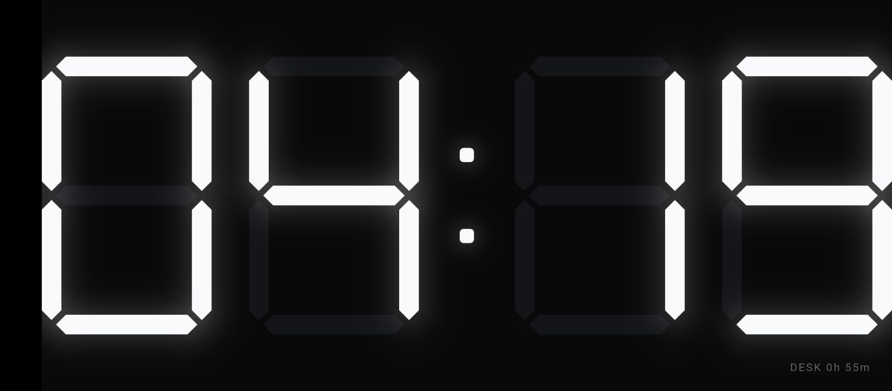
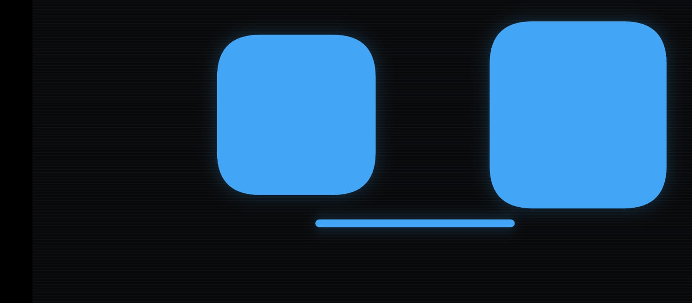
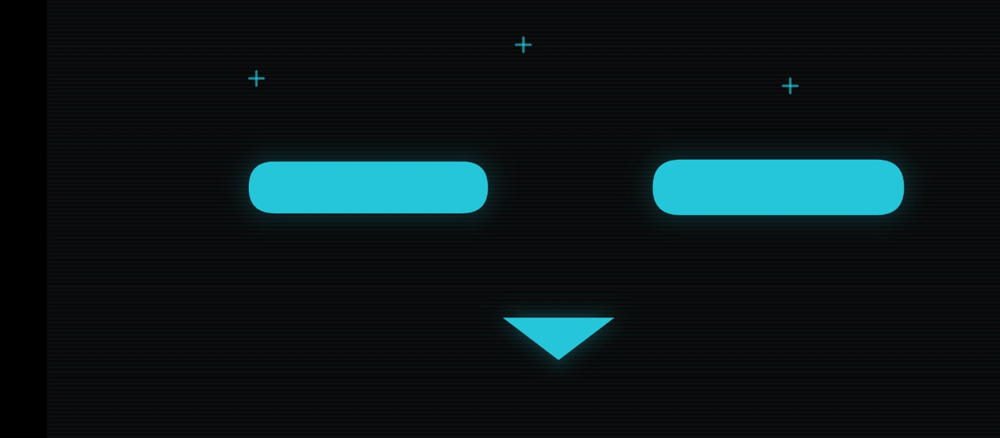
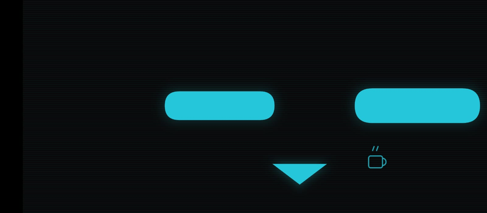
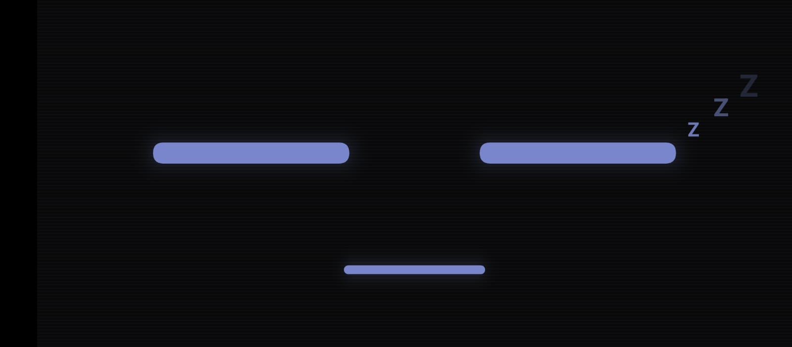
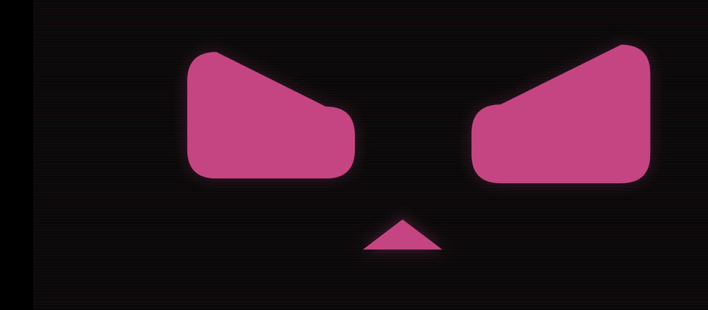
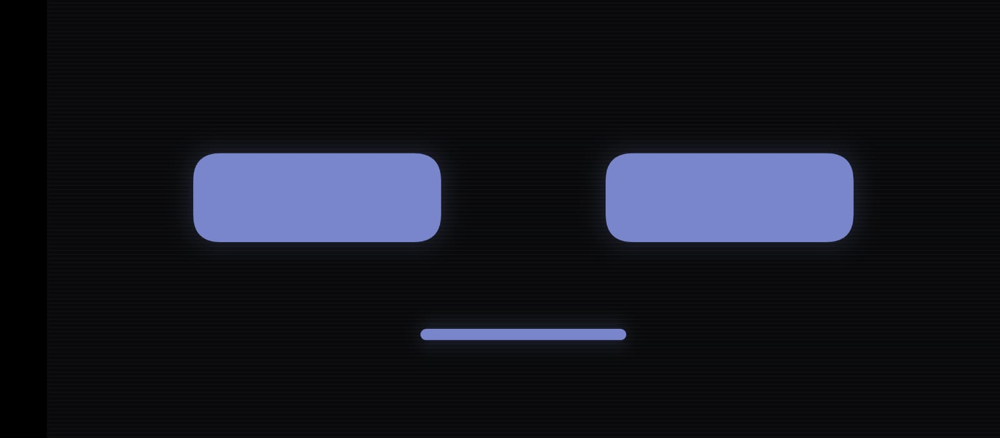

# Desk Display & Robo Gippy

<b>Desk Display is an ambient landscape application designed to turn your smartphone into a dedicated workstation dashboard when docked on a phone stand.</b>

Swipe vertically between two distinct modes:
1. **Digital Desk Clock & Work Tracker**: A minimalist glowing 7-segment digital clock accompanied by a persistent daily desk-time tracker.
2. **Robo Gippy (Cyber Desk Companion)**: An expressive, interactive virtual robot living inside your screen that observes you working, reacts to touch and tilts, takes naps, and periodically sips coffee.

<p align="center">
  <a href="https://flutter.dev"></a>
  <a href="#-downloads"></a>
  <a href="https://github.com/Kathrina-dev/desk-display/actions/runs/44829670887"></a>
</p>

---

## 📥 Downloads

| Platform | Build / Release | Details |
| :--- | :--- | :--- |
| **Android** | [`app-arm64-v8a-release.apk`](build/app/outputs/flutter-apk/app-arm64-v8a-release.apk) | Direct 64-bit ARM release APK (`build/app/outputs/flutter-apk/app-arm64-v8a-release.apk`) |
| **iOS** | [GitHub Actions Run #44829670887](https://github.com/Kathrina-dev/desk-display/actions/runs/44829670887) | Pre-built unsigned IPA (`desk-display-ios-unsigned`) ready for AltStore, Sideloadly, or TrollStore |

---

## Screenshots & Showcase

### 1. Minimalist 7-Segment Clock & Work Session Tracker
Features true OLED pitch-black background, glowing segments, pulsing colon, and session timer counting daily hours focused at your desk.

<p align="center">
  
</p>

---

### 2. The Many Moods of Robo Gippy
Rendered with custom vector shaders and CRT scanline effects, Gippy has a wide range of emotions and autonomous behaviors.

<table>
  <tr>
    <td align="center" width="50%">
      <br />
      <b>👀 Watching You Work</b><br />
      <i>Attentive blue glow, tracking your movement and keeping you company.</i>
    </td>
    <td align="center" width="50%">
      <br />
      <b>✨ Happy (Petting Reaction)</b><br />
      <i>Rub/pet Gippy gently on screen to trigger joyful sparkle bursts and glee!</i>
    </td>
  </tr>
  <tr>
    <td align="center" width="50%">
      <br />
      <b>☕ Coffee Break</b><br />
      <i>Glances down at a holographic coffee mug during idle work hours.</i>
    </td>
    <td align="center" width="50%">
      <br />
      <b>💤 Drowsy Nap</b><br />
      <i>Drifts off after extended quiet periods with floating "Z z Z" animations.</i>
    </td>
  </tr>
  <tr>
    <td align="center" width="50%">
      <br />
      <b>💢 Angry & Grumpy</b><br />
      <i>Gets irritated if tapped excessively or suddenly shaken awake from a nap!</i>
    </td>
    <td align="center" width="50%">
      <br />
      <b>🤖 Neutral Standby</b><br />
      <i>Relaxed ambient gaze while waiting for your next move.</i>
    </td>
  </tr>
</table>

---

## Features

### Glowing 7-Segment Flip Clock
- **OLED Dark Aesthetic**: Deep `#090909` background with high-contrast glowing digits.
- **Daily Desk-Time Tracker**: Bottom-right counter displays `DESK Xh YYm`, tracking cumulative time docked throughout the day.
- **Auto Session Persistence**: Flushes time to local storage every 10 seconds and rolls over automatically each calendar day.
- **Emergency Unlock**: A subtle 4-second hold on the desk-time label triggers an emergency release.

### Robo Gippy — Interactive Cyber Companion
- **Interactive Touch Responses**:
  - **Petting / Stroking**: Gentle dragging across the screen makes Gippy ecstatic, showering the display with sparkle crosses (`FaceEmotion.glee`).
  - **Coordinate Tracking**: Single tap makes Gippy's eyes dart directly to your touch point.
  - **Annoyance & Anger**: Tapping repeatedly or double-tapping drives Gippy furious. Waking him up abruptly triggers instant grumpiness!
- **Stand Tilt & Motion Awareness**:
  - Built-in accelerometer listener senses stand vibrations or tilt changes, triggering curious, suspicious, or skeptical looks.
- **Autonomous Routines & Idle Behaviors**:
  - **Visor Room Sweep**: Projects a laser sweep across the room.
  - **Holographic Coffee**: Periodically glances down at a steaming cup.
  - **Periodic Naps**: Powers down into soft drowsy eyelids with floating "Z z Z" after 90 seconds of inactivity.
  - **Mini Sneeze**: Quick scrunch, surprise, and blink sequence.
- **Circadian Rhythm**:
  - Automatically shifts personality between daytime focus and late-night nocturnal chill mode (lower blink rates, drowsier demeanor).

### Smart Dock & Stand Automations
- **NFC Stand Automation**: Docking onto an NFC tag automatically launches the app without creating duplicate tasks.
- **Lift Detection**: Accelerometer detects when you pick the phone off the desk stand, pausing the timer and exiting lock mode.
- **Immersive Mode & Wakelock**: Hides system bars and prevents the display from sleeping while on the stand.

---

## Setting Up NFC Tag Docking

You can automate launching **Desk Display** whenever your phone is placed on your stand:

1. Install **NFC Tools** (available on Google Play Store or iOS App Store).
2. Choose **Write** > **Add a record** > **Custom MIME**.
3. Set MIME type:
   ```text
   application/vnd.deskstand
   ```
4. Enter any small payload (e.g. `desk-display`).
5. Write the record to an NFC sticker placed on your phone stand.
6. Now, whenever your phone touches the stand, the app instantly launches into landscape mode!

---

## Building & Developing

### Prerequisites
- [Flutter SDK](https://docs.flutter.dev/get-started/install) (3.24+ recommended)
- Android SDK (API level 21+) / Xcode (for iOS)

### Installation

```bash
# Clone the repository
git clone https://github.com/Kathrina-dev/desk-display.git
cd desk-display

# Install Flutter dependencies
flutter pub get

# Run on a connected device in landscape mode
flutter run
```

### Building Release Packages

- **Android APK (split per ABI / ARM64)**:
  ```bash
  flutter build apk --release --target-platform android-arm64
  # Output: build/app/outputs/flutter-apk/app-arm64-v8a-release.apk
  ```

- **iOS Unsigned IPA**:
  Run through the provided GitHub Actions workflow [`.github/workflows/build_ios.yml`](.github/workflows/build_ios.yml) or package locally:
  ```bash
  flutter build ios --release --no-codesign
  ```

---

## Tech Architecture

- **UI Framework**: [Flutter](https://flutter.dev)
- **Vector Rendering**: Custom `Canvas` & `CustomPainter` (`EyeDrawer`, `SevenSegmentPainter`) with procedural glow shaders, animated scanlines, and slope calculations.
- **Sensors**: [`sensors_plus`](https://pub.dev/packages/sensors_plus) for accelerometer tilt and lift detection.
- **Screen Management**: [`wakelock_plus`](https://pub.dev/packages/wakelock_plus) for ambient always-on display.
- **Persistence**: [`shared_preferences`](https://pub.dev/packages/shared_preferences) for daily session logging.

---

## License

This project is licensed under the [MIT License](LICENSE).
